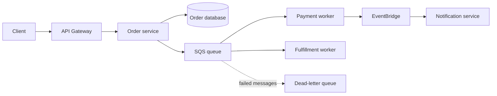

# Decoupled order processing

Each consumer can scale and retry independently. Confirm whether each business event should be delivered to every consumer; separate queues subscribed to an SNS topic can provide fan-out. Consumers should tolerate duplicate delivery and use idempotency keys for side effects.
