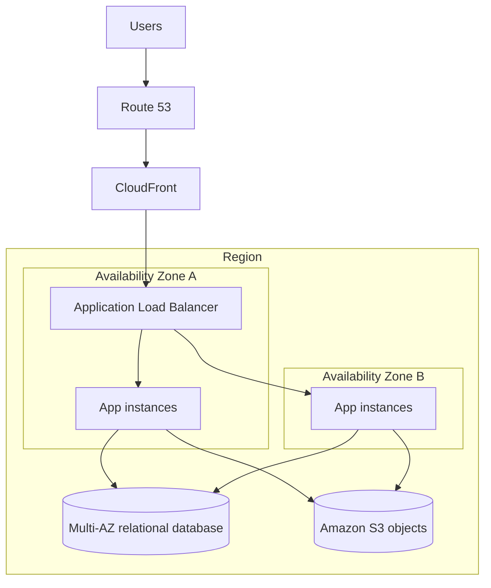

# Highly available web application

**Trade-offs:** Multi-AZ application capacity and database failover improve regional availability within one Region. CloudFront can cache eligible content near users. A Multi-AZ database is not a regional DR strategy; separately define backup and cross-Region recovery if required.
