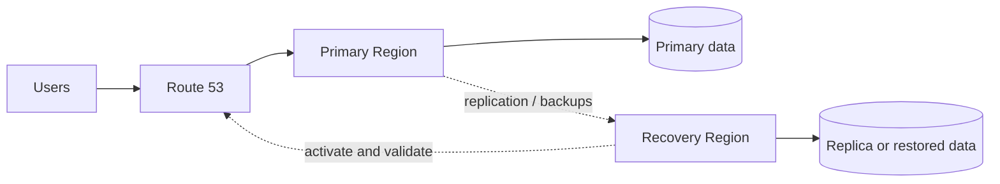

# Regional recovery pattern

The recovery Region can be backup-only, pilot light, warm standby, or active/active. DNS routing does not itself replicate data or validate application health. Define ownership, data consistency, promotion, failback, and testing procedures.
