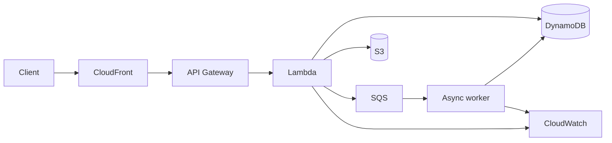

# Serverless web application

**Trade-offs:** This design reduces server management and separates asynchronous processing. Add authentication, scoped execution roles, idempotency, throttling, dead-letter handling, and alarms. Assess concurrency, quotas, data consistency, and per-request costs before selecting it.
