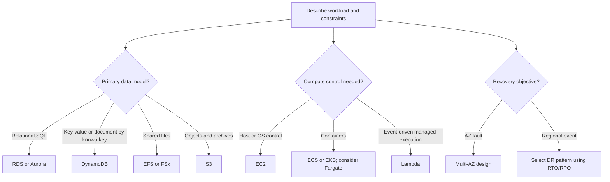

# Service-selection decision flow

Use this as a prompt, not a service recommender. A complete answer also accounts for security, integration, scaling, operational burden, availability, and total cost.
